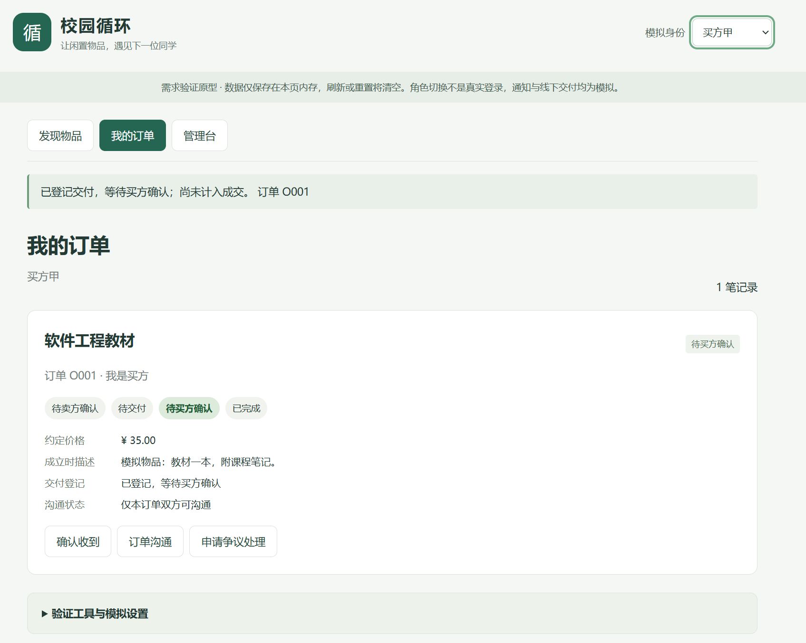
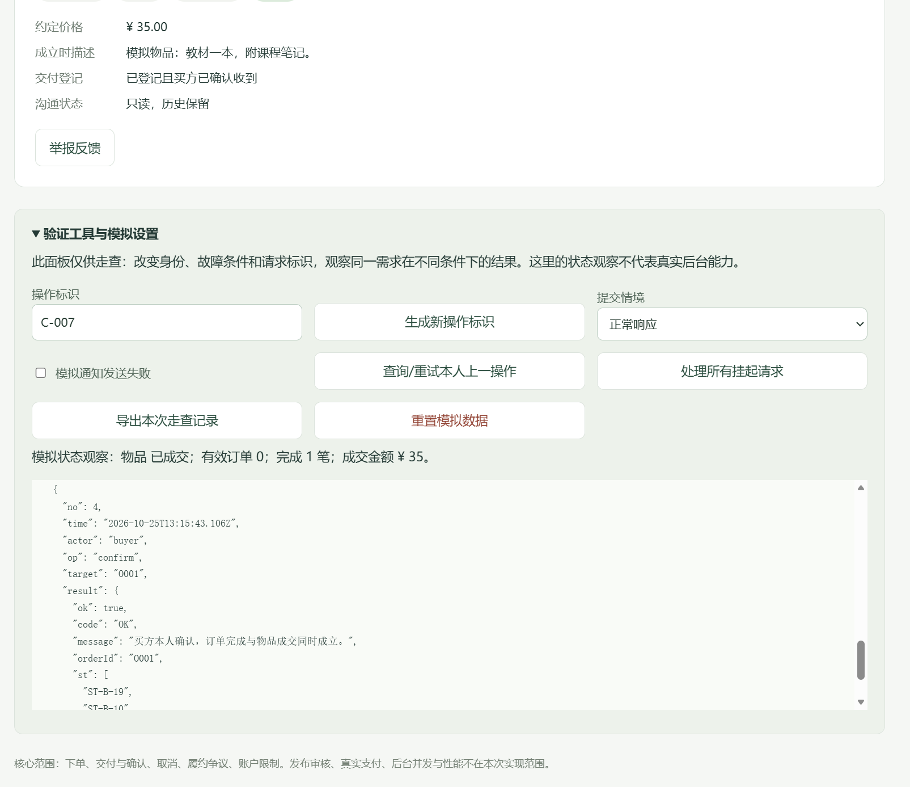

# E-D-13 人工走查记录

## 基本信息

- 验证编号：PV-D-H01；复用场景：SC-C-01“建立订单—交付—买方确认完整闭环”。
- 操作与观察人员：张霖（成员D）；日期：2026年10月25日。
- 业务角色：同一操作人员在原型中分别选择买方甲、卖方，手动执行页面操作。
- 原型：C-prototype-v1.1，本地可点击页面；身份、交付和统计均为模拟。
- 关联：UC05/06，BR06/08/18/20，ST-B-08/13/14/17/19/10。
- 初始数据：模拟教材I01，价格35元，尚无订单。

## 实际操作与观察

| 步骤 | 手动操作 | 预期结果 | 截图中可见的实际结果 |
| --- | --- | --- | --- |
| 1 | 买方甲确认下单。 | 建立订单并占用物品。 | 提供的过程截图显示订单O001，处于待卖方确认。 |
| 2 | 切换卖方并接受订单。 | 订单进入待交付。 | 提供的交付登记窗口背景显示“卖方已接单，等待线下交付”，订单处于待交付。 |
| 3 | 卖方填写模拟交付说明、勾选交付声明并提交。 | 登记后等待买方确认，不直接计为成交。 | 留存截图显示“已登记交付，等待买方确认；尚未计入成交”，订单O001处于待买方确认，约定价格35元。 |
| 4 | 切回买方甲，勾选收货声明并确认收到。 | 订单完成、物品成交，当前有效订单为0。 | 留存截图显示“已登记且买方已确认收到”、会话只读；状态观察为物品已成交、有效订单0、完成1笔、成交金额35元。可见确认请求返回ok=true。 |

结论：通过，限于SC-C-01这一次正常交易的人工模拟交互走查。上述步骤和观察依据成员提供的九张连续过程截图整理；正式附件只留存以下两张关键截图，其余原图仍保存在成员本地pics目录。

本次未检查异常、权限拒绝、重复请求或真实后台功能，不能用本记录替代这些场景的验证。AI仅协助筛选截图、核对可见结果和整理记录。

## 留存截图

图H-1 交付登记后等待买方确认

图H-2 买方确认后的成交结果

