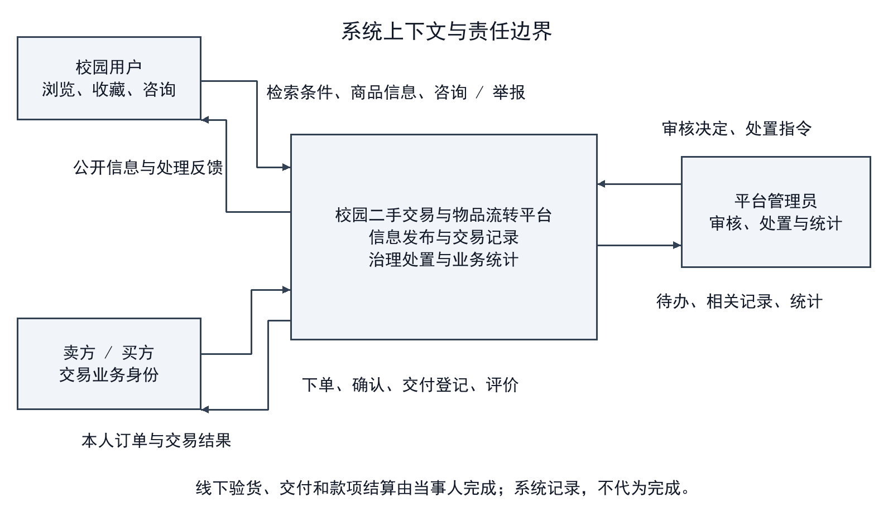
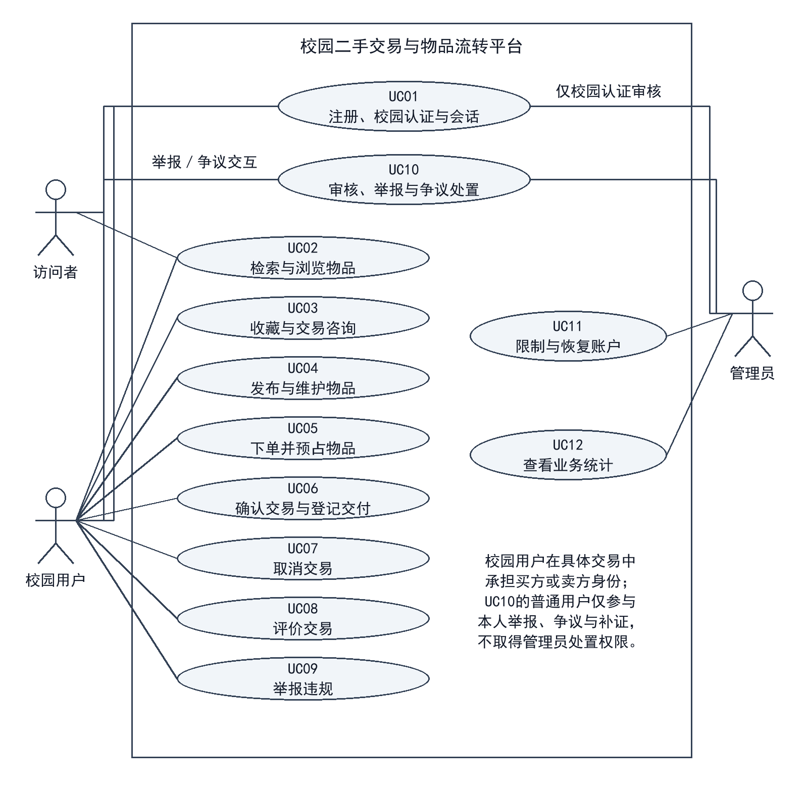
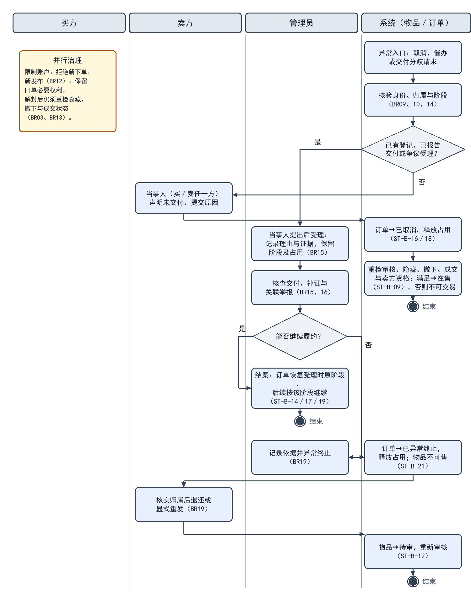
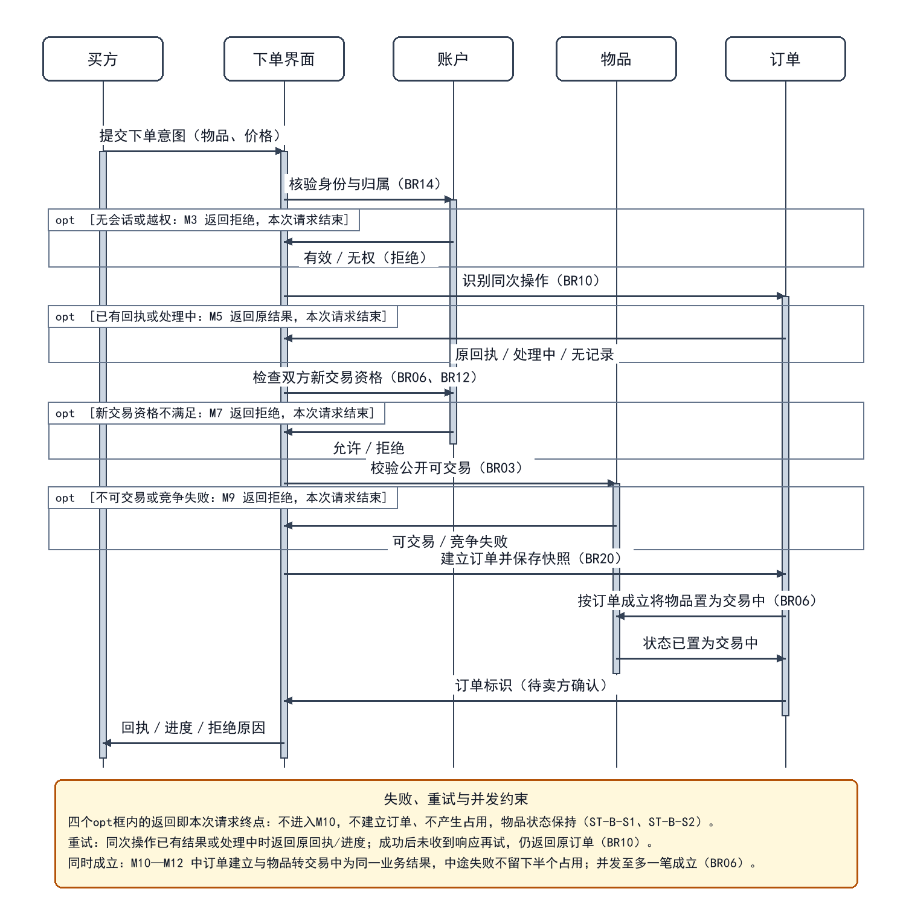

软件工程课程需求报告

校园二手交易与物品流转平台

张霖 蒋正友 郑思远 潘奕喆

## 1 项目概述

### 1.1 业务问题与项目背景

校园教材、学习工具、数码配件和生活用品具有阶段性使用特点。平台面向校园内部用户，将闲置物品的信息发布、检索咨询、交易确认和线下交付记录集中管理，并通过评价、举报和审核处置维护交易秩序。平台以单件实物交易为对象，重点解决信息难以集中发现、同一物品重复承诺、交付责任不清和违规处置影响既有订单等问题。

### 1.2 业务目标与成功指标

- 信息可发现：用户能够按关键词和分类找到符合公开条件的物品，查看完整描述，并向卖方咨询。

- 交易不重复：同一物品至多关联一笔有效订单；重复提交不增加订单，竞争失败不留下额外占用。

- 过程可追踪：审核、接单、交付登记、收货确认和争议处置均可关联原物品、订单与操作记录。

- 责任可区分：卖方登记交付，买方确认收到；管理员负责治理和争议结案，不得冒用当事人身份确认收货。

### 1.3 涉众、业务角色与确认责任

买方和卖方是校园用户在具体交易中的身份，同一账户可以在不同交易中承担不同身份。权限以对象归属和订单阶段判断，不因拥有某种身份便可操作他人的记录。

- 访问者：浏览公开物品并申请注册；不能执行发布、下单或其他需认证的操作。

- 校园用户：完成校园身份核验后使用交易服务。卖方对物品描述和交付登记负责，买方对购买意图和收货确认负责；双方可查看本人交易并参与争议处理。

- 管理员：审核校园资格与物品发布，处理举报和争议，实施隐藏、账户限制及恢复，并查看职责范围内的统计。

- 项目成员与业务评审者：依据业务资料和需求条目检查范围、规则与成果。业务规则变更须保留决定、影响及版本记录。

### 1.4 产品范围、非目标与业务概览

平台包括用户准入、物品发布审核、搜索筛选、收藏咨询、下单确认、线下交付记录、评价举报、账户治理、状态流转及统计。主路径为发布审核、下单预占、卖方接单、线下交付、买方确认和评价；取消与争议处理为交易提供退出路径。

图1-1 系统上下文图

图1-1明确系统与线下交接的边界。验货、实物交付和款项结算由当事人完成，平台保留操作及处置记录。本期不含在线支付、资金托管、快递、商家入驻、拍卖、多库存及登录凭据找回；凭据恢复留后续迭代，不等同UC11账户解封。图源与导出见附件索引E-A-06。

### 1.5 运行条件、外部依赖与约束

用户通过浏览器使用平台，校园资格经平台核验后生效。身份材料仅用于资格审核，不作为公开资料展示。交易依赖线下实物交接，系统确认表示业务记录成立，不表示平台已代为付款或检验物品质量。通知用于告知处理结果，送达失败不撤销已经成立的订单或处置，用户可在本人记录中查询。实现方案不得改变本说明书规定的身份、归属和交易结果。

## 2 用户需求

### 2.1 功能范围、需求清单与优先级

P1表示准入与交易闭环所必需的功能，P2表示支撑使用与治理的功能。优先级用于安排实现顺序，需求清单中的各项能力均属于本期范围。

表2-1 功能需求清单

| 编号 | 角色／触发 | 系统应提供的行为与结果 | 优先级 | 关联 |
| --- | --- | --- | --- | --- |
| FR01 | 访问者 | 注册账户并反馈成功或拒绝原因 | P1 | UC01／BR01 |
| FR02 | 注册用户 | 提交认证、查退回原因、修改后重提 | P1 | UC01／BR01、10 |
| FR03 | 卖方 | 提交包含必要描述和价格的物品供审核 | P1 | UC04／BR02、03 |
| FR04 | 管理员 | 通过或退回待审物品并保留原因 | P1 | UC10／BR03、16 |
| FR05 | 卖方 | 修改本人可修改物品，按变更范围执行重审 | P1 | UC04／BR04 |
| FR06 | 卖方 | 撤下本人尚无有效订单占用的物品 | P2 | UC04／BR05 |
| FR07 | 访问者／校园用户 | 检索物品，查看授权公开的卖方资料与评价 | P1 | UC02／BR11、13、14 |
| FR08 | 校园用户 | 收藏、物品咨询及未结束订单的专用沟通 | P2 | UC03、06／BR12、14、17 |
| FR09 | 买方 | 双方账户符合条件时下单，唯一建立订单和预占 | P1 | UC05／BR06 |
| FR10 | 卖方 | 接受或拒绝本人收到的待卖方确认订单 | P1 | UC06／BR07 |
| FR11 | 交易当事人 | 按登记、未交付声明及争议条件取消并留痕 | P1 | UC07／BR09 |
| FR12 | 系统 | 按订单终止原因及独立限制决定物品是否可交易 | P1 | UC07、10／BR05、12、13、19 |
| FR13 | 卖方 | 对待交付订单如实登记线下交付 | P1 | UC06／BR08 |
| FR14 | 买方 | 对本人已登记交付订单确认收到物品 | P1 | UC06／BR08、14 |
| FR15 | 交易当事人 | 查本人订单进度，登记后可提醒并申请处理 | P1 | UC06、10／BR14、16、19 |
| FR16 | 交易当事人 | 提交合资格评价，并按范围展示或查看 | P2 | UC08／BR11、14 |
| FR17 | 校园用户 | 对物品或违规行为提交举报并查本人处理结果 | P2 | UC09／BR15 |
| FR18 | 管理员 | 关联核查同事件举报，保留各条回执与依据 | P2 | UC10／BR15、16 |
| FR19 | 管理员 | 限制或恢复违规账户并记录原因及依据 | P2 | UC11／BR12、16 |
| FR20 | 系统 | 阻止受限账户及其物品建立新交易，保留旧单处理 | P1 | UC11／BR12 |
| FR21 | 管理员 | 按明确统计口径查看发布、成交与治理数据 | P2 | UC12／BR18 |
| FR22 | 系统 | 对审核、关键交易和治理操作保留可关联记录 | P1 | UC04—UC12／BR16 |
| FR23 | 注册用户 | 登录退出本人会话；本期不含凭据找回和重置 | P1 | UC01／BR01、14 |
| FR24 | 交易当事人／管理员 | 处理未结束订单履约争议、补证及结案 | P1 | UC10／BR15、19 |

### 2.2 用户故事与角色场景覆盖

用户故事说明角色希望获得的业务价值，用于安排需求优先级；用例说明实现该目标时的触发、前提、交互、异常与结果。两者通过FR和UC编号关联，允许一对多或多对一；具体步骤见2.3—2.4，业务规则统一引用第4章。

- US01 发现与沟通：作为校园用户，希望检索并咨询目标物品，以判断是否适合购买。关联FR07—08、UC02—03。

- US02 发布与维护：作为卖方，希望提交准确的物品信息并获知审核结果，以便合法、清晰地展示物品。关联FR03—06、UC04、UC10-a。

- US03 建立交易：作为买方，希望一次下单形成唯一订单，避免一件物品被重复承诺。关联FR09、UC05。

- US04-a 交付与收货：作为交易当事人，希望沟通交接、登记交付并获知待买方确认进度，以便完成交接和保留凭据。关联FR08、FR10、FR13—15、UC03-b、UC06。

- US04-b 取消交易：作为交易当事人，希望在未实际交付且系统允许的阶段取消订单并获知结果，以便结束不再履行的交易。关联FR11—12、UC07。

- US04-c 争议处理：作为交易当事人，希望对未结束订单提交履约争议并获知处理结果，以便恢复履约或结束无法继续的交易。关联FR24、UC10-b。

- US05-a 评价与举报：作为校园用户，希望评价已完成交易或举报违规行为，以便反馈交易体验并维护交易秩序。关联FR16—17、UC08—09。

- US05-b 审核与治理：作为管理员，希望审核物品、处理举报并限制违规账户，以便执行平台规则并保留处置依据。关联FR04、FR18—20、FR22、UC10—11。

- US05-c 运营统计：作为管理员，希望按统一口径查看发布、成交和治理数据，以便掌握平台运行情况。关联FR21、UC12。

- US06 账户与资格：作为校园用户，希望注册、完成校园认证并安全登录和退出，以便使用本人有权访问的交易服务。关联FR01—02、FR23、UC01。

场景覆盖包括正常主流程、权限拒绝、状态变化和异常恢复：访问者核验失败时不能下单；卖方审核退回后可修改重提；买方竞争失败不产生占用；当事人可在允许阶段取消，交付有争议时转处理流程；管理员的隐藏与账户限制不得抹除历史交易。

### 2.3 用例模型及说明位置

图2-1 UML用例图

图2-1中，管理员参与UC01校园认证审核；用户参与UC10本人举报、争议和补证。UC01、UC03、UC04、UC10为概览分组，子流程分别规定触发、条件和结果；旧单沟通仍由交易双方参与，不增加治理权限。图源与导出见附件索引E-A-07。

- UC01-a 注册：访问者提交账户资料；账户标识未被占用时建立账户，重复标识或缺少必要资料时拒绝，不授予认证权限。

- UC01-b 校园认证：用户提交本人资格材料，管理员审核当前版本；退回须说明原因。用户可修改材料并显式重提，系统保存新版本和历次结果，重新进入审核；通过前不授予认证权限，重复重提不新增审核任务。关联FR02、BR01、BR10。

- UC01-c 登录：凭据正确时建立本人会话；凭据错误不得登录，未认证者不获交易权限。本期不含忘记密码找回、凭据重置及无法登录后的自助恢复，列入后续迭代；认证重提或重新注册不能绕过旧账户限制。关联FR23、BR01、BR12。

- UC01-d 退出：已登录用户主动退出时终止本人会话；会话失效后不得沿用旧身份操作，重新登录后按当前资格判断权限。关联FR23、BR01。

- UC02 检索浏览：访问者或用户查询公开可交易物品，无结果返回空列表；隐藏、成交或卖方受限的物品不提供交易入口。公开卖方信息仅含昵称、有效校园认证标记及已公开评价，不展示真实姓名、学号、认证材料、联系方式或私有订单。关联FR07、BR13—14。

- UC03-a 收藏：认证用户收藏或取消收藏，维护本人唯一关系；对象不可访问时拒绝，不形成交易占用。

- UC03-b 沟通：有资格用户可就物品发起咨询；订单双方可在未结束订单中打开专用会话，沟通交接或核查事项，受限账户也保留此权利。订单结束后该会话只读，举报补证另走UC10；不得借旧单发起无关新交易。关联FR08、FR15、BR12、BR14、BR17。

- UC08 评价：完成订单双方各可评价一次，重复提交不追加。访问者和用户可查看卖方信息区的已公开交易评价；当事人可在本人订单中查看该单评价。治理隐藏的评价不公开展示，评价不得暴露私有订单、身份材料或联系方式。关联FR16、BR11、BR14。

- UC09 举报：用户提交对象、理由及证据并查询本人结果。同对象同事件可关联核查，但各举报保留编号、证据及回执，不向举报人暴露他人身份。终态订单反馈走一般举报，不重开、不新增占用、不改成交。关联FR17—18、UC10-b、BR15—16。

- UC11 限制与恢复账户：管理员依据处置记录限制或恢复账户；限制立即阻止相关新交易，恢复后重新判断全部可交易条件。关联FR19—20。

- UC12 业务统计：管理员选择统计范围，按完成订单及治理记录汇总；不得把预占或交付登记计为成交。关联FR21。

### 2.4 关键详细用例与其他用例摘要

以下用例规定核心流程及业务通过条件。UC04包含发布、关键修改和撤下三个子流程；UC10分别说明发布审核与举报争议处置，二者共享管理入口，不混用触发条件。

#### 2.4.1 UC04 发布与维护物品

参与者与触发：卖方提交新物品、修改本人信息或申请撤下。账户已认证且不受发布限制；修改和撤下还须满足对象归属及订单条件。

（1） 发布：填写标题、分类、描述、价格和图片，系统校验后保存本次提交版本并置为待审，公开列表不展示待审物品。

（2） 修改：无有效订单时，可修改本人描述、图片或价格等关键内容；修改版本重新审核，旧版本的通过结论不沿用。

（3） 撤下：仅对无有效订单的本人物品生效，保留发布与交易历史；再次发布须显式提交并重新审核。

替代与异常：必填缺失或格式错误时保留可安全保留的输入，不生成有效发布；越权、账户受限或占用中撤下均拒绝；同一提交意图重试只产生一次业务效果。

后置结果：新发布或关键修改进入待审；撤下后不可公开交易；失败不改变原物品和有效订单。

业务通过条件：未认证发布被拒绝；待审内容不能下单；有有效订单时不能修改交易标的、价格或撤下；重新提交的审核对象与最新版本一致。 关联：FR03、FR05—06、FR22；BR01—05、BR10、BR13、BR16。

#### 2.4.2 UC05 下单并预占物品

参与者与触发：买方在物品详情确认下单。新意图须满足双方账户有新交易资格、非自买、物品审核通过且无隐藏、撤下、成交及有效占用；已识别的同次操作重试按BR10返回已有结果。

（1） 买方核对描述和价格并提交意图。系统先核验当前登录身份及请求归属，再识别同次操作；已有结果时返回对应回执，不重新执行新下单检查。仅新意图检查双方资格、物品限制及占用。

（2） 系统使订单建立和物品预占同时成立，保存本次物品描述、价格及交易双方信息快照。

（3） 返回待卖方确认的订单标识；双方可以查询本人订单。同次操作尚在处理时返回处理中及查询入口，不另建订单；重试回执附对应订单的当前进度。

替代与异常：新意图遇卖方或买方受限、物品条件变化、自买、越权或竞争失败时拒绝。不同意图不得复用回执，同一意图更改物品或关键内容时拒绝；无权访问的请求不得取得旧回执。

后置结果：成功形成唯一有效订单及对应占用；失败不产生孤立订单或残留占用。

业务通过条件：两人竞争同一物品时至多一笔成功，失败不留占用；成功后丢失响应，再以同次意图重试，应返回原订单而非“已占用”；同次处理中的请求不新增订单；受限卖方物品不能接收新意图。关联FR09、FR15、FR20、FR22；BR06、BR10、BR12—14、BR20。

#### 2.4.3 UC06 确认交易与登记交付

参与者与触发：卖方处理本人待卖方确认订单；接受后双方开展线下交接。各操作必须符合订单当前阶段，订单不是已终止或已完成状态。

（1） 卖方接受后进入待交付，双方可用订单专用会话约定交接；账户受限仍可就旧单沟通。拒单按独立限制判断物品可售性。

（2） 双方在线下验货并交接物品及款项后，卖方及时提交交付登记；系统保存记录并进入待买方确认。实际交付尚未登记时，应补登记；对交付事实有分歧时按UC10-b核查。

（3） 买方核实收到物品后由本人确认，系统同时记录订单完成与物品成交，并保留双方查询和评价入口。

替代与异常：越权、管理员代确认、登记前收货均拒绝。登记后买方未回应时，卖方可发起一次站内提醒并申请管理员处理；同一待买方确认阶段重复提醒不新增通知。期间保留阶段与占用，不自动成交或取消。关联UC10-b、BR19。

后置结果：交付登记不等于成交；买方确认后才完成。争议处理可继续履约、确认收到后结案，或异常终止。

业务通过条件：登记不计成交；买方本人确认后仅计一次。受限账户仍可沟通旧单；提醒或申请处理不改变交易结果，管理员不得代收货。关联FR08、FR10、FR13—16、FR22、FR24；BR07—08、BR10—12、BR14—19。

#### 2.4.4 UC07 取消交易

参与者与触发：当事人申请结束本人待卖方确认或待交付订单，并声明尚未实际交付。卖方拒单与普通取消分别留痕。平台以交付登记、争议标记及该声明判断资格，不自动识别线下事实。

（1） 核对订单、归属及取消影响。仅尚无交付登记、无处理中争议，且当事人声明未实际交付时，才进入普通取消；任何一方报告已实际交付或双方陈述冲突时，阻止普通取消并转争议核查。

（2） 当事人提交原因并确认后，系统再次核对阶段、交付登记及争议标记，将取消结果和解除本订单占用作为同一业务结果记录，并保留操作者、时间和未交付声明。

（3） 重新检查审核、隐藏、撤下、成交事实和卖方账户资格，符合全部条件时才恢复可交易；保留订单历史。

替代与异常：已有交付登记、已结束或争议处理中的订单不得普通取消；实际已交付但未登记的，应补登记或提交争议。取消与交付登记并发时，以系统先成立的合法操作为界；后成立请求拒绝，不覆盖原结果。

后置结果：取消成功不再形成有效占用，但不会解除独立隐藏、撤下或账户限制；拒绝不改变原业务结果。

业务通过条件：已有登记则取消被拒绝；取消先成立则后续交付登记被拒绝；未登记但已报告实际交付时不得普通取消；隐藏或封禁后取消不恢复物品可售。关联FR11—12、FR15、FR22；BR05、BR09—10、BR12—13、BR15—16。

#### 2.4.5 UC10 审核与违规处置

参与者与触发：管理员审核发布，或核查举报、未结束订单争议及登记后未回应的处理申请。用户可提交本人申请和补证；履约争议仍限待卖方确认、待交付、待买方确认阶段。

（1） UC10-a发布审核：核对发布资格和当前提交内容，记录通过或退回及原因；通过后仍检查独立隐藏、撤下、成交、账户和占用条件。

（2） UC10-b举报与争议：登记对象、理由和证据；同对象同事件可关联处理，保留每条记录及各自回执，不同事实不得强行合并。未结束订单履约分歧走争议，终态反馈走一般举报，不重开或新增占用。

（3） 受理争议或未回应申请后保留原阶段及已有占用，指定管理员联系双方、核查交付和补证。同一对象新增证据须核对已有结论，不因已关联或已结案而直接忽略；举报数量不直接判定违规。

（4） 核查后可恢复履约，或在卖方登记后由买方本人确认完成；有无法履约或争议无法消除的核查依据时可异常终止。买方未回应不视为收货，也不单独构成异常终止依据，不执行超时自动成交。

替代与异常：越权、目标不存在或无理由处置均拒绝。证据不足时进入补证核查，不直接判定违规；继续履约失败可转异常终止，不能把争议永久悬置作为处理结果。

后置结果：未结束订单异常终止时解除原订单占用，但物品保持不可交易；核实持有或退还情况后，卖方方可重发审核。已结束订单举报仅追加治理记录，不撤销历史成交。资金由双方线下处理，平台不退款。

业务通过条件：申请有责任人和查询结果，催办不代收货；关联举报各保留证据和回执；异常终止不计成交且不直接恢复可售；终态举报不重开、不改成交。关联FR04、FR15、FR17—20、FR22、FR24；BR03、BR12—16、BR18—19。

### 2.5 任务交互、页面流程与反馈

核心任务采用“发现物品—核对交易内容—本人订单—交付与处理结果”的连续路径。公开入口仅展示BR03允许交易的物品及BR14允许的卖方信息；本人订单按归属展示成立时快照、当前阶段、登记及争议标记。管理入口与当事人入口分开，治理身份不提供代下单、代登记或代收货操作。

表2-2 关键交互与反馈要求

| 任务 | 输入及操作 | 反馈与恢复 | 关联 |
| --- | --- | --- | --- |
| 下单与查询 | 核对物品、约定价格及本次购买意图 | 成功返回订单；处理中或结果未知时保留原意图并提供查询，不引导反复新建订单 | UC05；BR06、10、20 |
| 交付与收货 | 卖方登记实际交付说明；买方本人确认收到 | 登记后明确“待买方确认”，不得显示成交；越权和阶段冲突说明原因，保持原结果 | UC06；BR08、14 |
| 普通取消 | 原因、未实际交付声明、确认取消影响 | 缺声明保留可安全保留的输入；已登记、报告已交付或受理争议时拒绝普通取消并提示补登记或争议入口 | UC07；BR09 |
| 争议与治理 | 对象、理由、证据及核查依据 | 展示原订单阶段及争议标记；继续履约按原阶段恢复，异常终止明确物品不可直接重售 | UC10、11；BR12、15、19 |
| 旧单沟通与终态反馈 | 当事人输入交接信息、提醒或反馈 | 受限账户保留旧单必要入口；终态会话只读，反馈转举报且不重开订单 | UC03、06、09；BR12、17、19 |

输入缺失、资格不符和状态已变化应给出可理解的原因；返回、取消编辑不得提交业务操作。空列表说明暂无可交易物品并提供本人订单入口。重复回执应显示原订单当前进度；修改关键内容属于新操作，不能复用原意图。公开页不出现私有订单、真实姓名、学号、认证材料、联系方式或交接地点。具体业务条件以第4章为准，不由页面提示改变。

### 2.6 外部接口与人工交接

外部交互包括结果通知、校园资格审核与线下交付记录。通知反馈及人工交接遵守本节规定。

表2-3 外部依赖与人工交接要求

| 交互 | 输入与责任 | 输出与业务处理 | 边界及关联 |
| --- | --- | --- | --- |
| 结果通知 | 系统在审核、交易或处置结果成立后请求通知；仅向有权接收者发送必要信息 | 失败不撤销已成立结果；用户可查询本人业务记录；重发不得重复执行业务 | 1.5、BR14、16 |
| 校园资格审核 | 用户提交本人材料，授权管理员审核当前版本并登记原因 | 返回审核结论；退回后显式重提，旧记录保留；未通过不授予交易资格 | UC01；BR01、10 |
| 线下交付 | 双方线下验货与结算，卖方登记说明，买方本人确认 | 保存登记与确认事实；有分歧进入争议，平台不自动判定实物交付及款项结算 | UC06、07、10；BR08、09、19 |

人工补证和核查由实际参与者提供依据，系统记录对象、操作者、时间及处理结果。通知失败时查询原订单的路径应保持可用；外部材料不足时保留待核查状态，不以接口成功回执替代人的事实确认。

## 3 领域与数据

### 3.1 统一术语与关键参数引用

本章统一业务概念、分析类、关系、职责和关键数据。业务规则与数值以第4章为准，本章只引用BR编号。

表3-1 术语与关键参数表

| 术语／参数 | 含义与取值口径 | 适用条件 | 来源与状态 |
| --- | --- | --- | --- |
| 单件物品与价格 | 一次发布对应一件实物，不设库存与拆分；价格为人民币元正数总价，款项由双方线下结算 | 发布、下单、统计 | BR02、BR18；不含多库存与在线支付 |
| 公开可交易 | 当前版本审核通过，且未隐藏、未撤下、未成交、无有效占用、卖方未受限 | 列表展示与下单入口 | BR03、BR04、BR13 |
| 有效订单与占用 | 已建立且未取消、拒绝、异常终止或完成的订单；占用是有效订单对物品的排他资格，随订单成立与终止变化 | 判断阶段、可售与统计 | BR06、BR09、BR19 |
| 订单阶段 | 待卖方确认、待交付、待买方确认三个未结束阶段 | 当事人操作与争议受理 | BR07—BR09、BR15 |
| 履约争议 | 未结束订单当事人就交付或履约提出的处理申请，受理保留原阶段与占用 | 限三个未结束阶段 | BR15、BR19 |
| 交付登记、成交与评价 | 卖方提交的线下交接记录；买方本人确认后订单完成、物品成交；完成订单双方各1次评价 | 登记不构成成交；未完成不评价 | BR08、BR11、BR18 |
| 关键修改与快照 | 描述、图片、价格等影响标的的修改；快照为成立时的描述、价格与双方信息 | 修改重审；快照不回写 | BR04、BR20 |
| 隐藏标记、撤下与受限账户 | 隐藏是治理标记，不改变状态；撤下对应状态"已撤下"；受限账户保留旧单必要权利 | 隐藏按BR13；撤下按BR05；受限按BR12 | BR05、BR12、BR13 |
| 记录保留与成交统计 | 审核、交易、处置与争议记录保留操作者、时间、原因和结果；成交按完成订单去重，同一待买方确认阶段至多1次提醒 | 终止、隐藏、限制不删除历史 | BR16、BR18、BR19 |

价格、次数和记录字段的数值口径来自4.1。统计、提醒、通知及数据保留的处理口径见8.3及附件E-B-08。

### 3.2 核心分析类识别与取舍

候选对象从UC01—UC12、FR01—FR24和BR01—BR20中提取，按"是否有业务事实需要长期保存、是否承担判断或行为职责"决定保留、合并或排除。界面控件、技术组件和外部服务不作为分析类；业务操作在3.4说明，图中不列方法。

表3-2 分析类识别与取舍表

| 候选对象 | 主要来源 | 处理 | 关键属性或职责要点 | 取舍理由 |
| --- | --- | --- | --- | --- |
| 账户 | UC01、UC11；BR01、BR12、BR14 | 保留（实体类） | 账户标识、昵称、账户状态 | 资格与归属判断的主体；昵称与认证属公开边界 |
| 校园认证 | UC01-b；BR01、BR14 | 保留（账户1:0..1，按版本） | 认证状态、材料版本、审核结论 | 需保留退回原因和历次版本；未提交认证时不建立记录 |
| 物品 | UC02—UC07；BR02—BR05、BR13 | 保留（实体类） | 标题、分类、描述、价格、图片、审核状态、生命周期状态、隐藏标记 | 交易标的与公开展示对象 |
| 收藏 | UC03-a；BR17 | 保留（关联对象） | 收藏时间 | 唯一关系，不占用物品、不进入订单 |
| 订单、订单快照、交付登记 | UC05—UC07；BR06—BR09、BR20 | 保留（订单及组合对象） | 订单号、阶段、终止原因；快照内容；登记人、时间、说明 | 阶段、历史约定和交付事实需分别保存 |
| 评价与会话 | UC08、UC03-b、UC06；BR11、BR17 | 保留 | 评价人、评分、内容、公开状态；会话类型、只读状态、两个参与账户 | 完成订单各一次；旧单沟通与物品咨询需区分 |
| 举报与履约争议 | UC09、UC10-b；BR15、BR19 | 保留（两个类） | 举报对象类型、理由、证据、回执；争议理由、补证、结论 | 二者分流，争议限未结束订单 |
| 处置记录 | UC01-b、UC04、UC09—UC11；BR16 | 合并保留 | 类型、对象标识、操作者、时间、原因、结果 | 审核、举报、争议、隐藏与限制共用同一历史字段 |
| 物品分类、通知、统计与非目标 | FR03、1.5、UC12；BR18、1.4 | 合并或排除 | 分类名称；送达状态；指标与口径 | 分类无独立维护需求；通知失败不撤销结果；统计为计算值；支付、物流、库存、拍卖不在本期 |

边界类为下单界面、物品详情与审核界面，只承担输入输出；控制职责分散在对象协作中，下单由订单建立订单、物品转换状态，不设承担全部判断的"系统类"。数据表结构、索引与实现类留待设计阶段。

### 3.3 对象关系、数量与领域模型

图3-1 领域类图

本图建模对象为账户、校园认证、物品、收藏、订单、订单快照、交付登记、评价、会话、举报、履约争议和处置记录，关联FR01—FR24、UC01—UC12与BR02—BR20；源与导出见附件索引E-B-01。

账户侧：账户与校园认证为1:0..1（未提交不建记录）；账户发布物品1:0..*；账户在订单中承担买方或卖方，每个角色各对应1个账户；收藏为账户与物品间的关联对象，同一账户对同一物品至多一条，不产生占用（BR17）；账户与会话为2:0..*，每个会话恰有买卖双方两个参与账户。

物品与订单为1:0..*，表示同一物品可有多笔历史订单；"至多一笔有效订单"（BR06）不能只靠基数表达，由订单阶段与物品状态共同保证：订单建立与物品转交易中同时成立（ST-B-08、ST-B-13），取消或拒单后重检可售条件（ST-B-09），异常终止释放占用但物品不可售（ST-B-11），买方确认后成交（ST-B-10、ST-B-19）。订单与快照1:1、与交付登记1:0..1、与评价1:0..2、与履约争议1:0..*（BR08、BR11、BR20）。举报对物品为可选的0..1（对象也可能是账户或已结束订单）；举报、争议与处置记录为0..1:0..*，审核、隐藏和限制记录以对象类型引用，未关联时不强行绑定（BR16）。

隐藏标记和账户受限不改变物品生命周期状态，解除后按BR03重判；撤下则是状态"已撤下"，须显式重发才回到待审（BR05、BR13）。业务关系不因终止而删除：订单、交付登记、评价与处置记录保留，快照只读，物品资料修改不回写历史约定。

### 3.4 对象职责与用例覆盖

表3-3 类职责表

| 类 | 业务信息职责 | 判断职责 | 行为职责 | 不承担 |
| --- | --- | --- | --- | --- |
| 账户 | 身份、昵称、账户状态 | 是否具备新交易、发布与收藏资格（BR12） | 保存状态与限制结果 | 不判断订单阶段，不代替管理员处置 |
| 校园认证 | 材料版本、认证状态、结论 | 当前版本是否通过 | 保存历次版本 | 不直接授予交易权限 |
| 物品 | 描述、价格、审核与生命周期状态、隐藏标记 | 是否满足公开可交易条件（BR03） | 保存提交版本；按审核结果改审核状态，按订单结果转换生命周期状态 | 不建立订单，不决定占用是否成立 |
| 收藏 | 收藏关系与时间 | 是否已收藏 | 建立或取消 | 不占用物品 |
| 订单 | 阶段、建立时间、终止原因、快照 | 当前阶段允许的操作（BR07—BR09、BR19） | 建立、接受、拒单、推进、取消、异常终止、完成；确定占用成立与解除 | 不判定线下事实，不改审核结论 |
| 订单快照 | 成立时的描述、价格、双方信息 | — | 保存成立时内容 | 不回写物品 |
| 交付登记 | 登记人、时间、说明 | 是否已有有效登记（取消前提） | 保存登记 | 不产生成交 |
| 评价 | 评价人、评分、内容、公开状态 | 是否具备评价资格（BR11） | 记录、公开或隐藏 | 不影响订单阶段与统计 |
| 会话 | 类型、只读状态、两个参与账户 | 参与人范围 | 打开、关闭、转只读 | 不改变交易状态 |
| 举报 | 对象类型、理由、证据、回执 | 对象是否存在、是否可受理 | 登记、生成回执 | 不重开订单 |
| 履约争议 | 理由、补证、结论 | 是否属未结束订单 | 受理、记录、结案 | 不代替管理员裁决 |
| 处置记录 | 类型、对象、操作者、时间、原因、结果 | — | 追加记录 | 不删除历史 |

12个用例均有承担判断或保存事实的对象，未出现无人承担的行为。订单负责建立订单、确定占用成立与解除，物品只判断可售并转换自身状态，职责不集中于单一"系统类"。完整用例—职责覆盖核对见附件E-B-07表A-1；UC02、UC12以查询和计算为主，不新增持久对象。

### 3.5 关键数据字典与记录生命周期

表3-4只列业务数据项的含义、约束、维护角色、隐私属性与访问规则，不规定数据库类型、索引和加密实现。隐私属性分为公开、私有、当事人私有、治理敏感和高度敏感；访问规则均以BR14的归属判断为前提。

表3-4 关键数据字典

| 数据项 | 含义与约束 | 维护角色 | 隐私与访问 | 关联 |
| --- | --- | --- | --- | --- |
| 账户标识与昵称 | 唯一标识不复用；昵称不含真实姓名、学号 | 系统、用户 | 标识非公开；公开页显示昵称 | FR01；BR14 |
| 账户状态与认证 | 正常或受限；材料版本、状态与结论，仅审核用并保留历次版本 | 管理员 | 状态本人可见；材料仅审核范围 | FR02、FR19；BR01、BR12、BR16 |
| 物品发布内容 | 标题、分类、描述、图片、价格；单件实物、必填、价格为正 | 卖方 | 公开（成交前） | FR03；BR02、BR14 |
| 审核、生命周期与隐藏标记 | 待审、通过、退回；状态只能按表5-2转换；隐藏不改变状态 | 管理员、系统 | 本人及治理；公开页只展示在售 | BR03、BR04、BR13、BR16 |
| 占用与订单阶段 | 至多一个占用；阶段只能按表5-2转换 | 系统 | 当事人及治理 | FR15；BR06、BR08、BR14 |
| 订单快照与交付登记 | 快照为成立时的描述、价格与双方信息，只读；登记人、时间、说明，登记后不得普通取消 | 系统、卖方 | 当事人及治理 | BR08、BR09、BR20 |
| 评价与会话 | 完成订单各一次；会话仅双方，终态只读 | 买方或卖方 | 公开评价区或当事人、治理 | BR11、BR14、BR17 |
| 举报、争议与处置记录 | 举报人身份不公开；争议限未结束订单；处置记录追加不删除 | 用户、管理员 | 本人回执、当事人及授权治理 | BR15、BR16、BR19 |
| 成交统计与收藏 | 完成订单去重与金额；收藏唯一且不占用 | 系统、校园用户 | 管理员职责范围；本人收藏 | BR17、BR18 |

记录生命周期按"追加事实、保留历史、按需限制展示"处理：

- 创建与修改：物品与认证材料按版本保存；订单、交付登记、评价、举报、履约争议和处置记录均为追加记录。

- 保留与更正：终止、隐藏、限制和结案不删除原记录；更正以追加说明表达，不覆盖原操作者和时间；快照自成立起只读。

- 统计与会话：统计为计算值，导出时注明口径与截止时点；订单终态后会话只读，补证另走UC10。

- 删除与隐私：本期不提供自助删除；公开信息仅含昵称、已审核物品内容、有效认证标记和已公开评价。

- 隐私最小化：公开信息只含昵称、已审核物品内容、有效认证标记和已公开评价；真实姓名、学号、认证材料、联系方式和交接地点不公开，管理员仅因审核治理按需访问并留痕。

## 4 规则与权限

### 4.1 允许、禁止与计算规则

以下规则统一约束用例、状态变化、交互和验收。规则条件同时适用时，应满足全部条件；旧订单的必要处理权按BR12保留。

- BR01 校园准入：注册、认证和登录分开。认证退回可按原因修改并显式重提，新版本重新审核、旧记录保留；通过前不授予认证权限。公开浏览无需认证；会话失效不允许私有操作，凭据恢复不在本期范围。

- BR02 发布内容：单件实物须具备标题、分类、描述、正数人民币价格和必要图片；本期不含免费赠送及多库存销售。

- BR03 审核门槛：物品仅在当前版本审核通过、未隐藏、未撤下、未成交、无有效占用且卖方未受限时公开交易。审核通过不解除其他限制。

- BR04 关键修改：描述、图片和价格等关键修改重新审核；有效订单存在时禁止改变标的及约定价格。旧审核结论不得用于新关键版本。

- BR05 撤下与重发：本人无有效订单的物品可撤下；撤下不删除历史。再次发布需显式提交并审核，不由订单终止自动触发。

- BR06 唯一占用：单件物品至多一笔有效订单，禁止自买。有效订单指已建立且未取消、拒绝、异常终止或完成的订单；建立订单与预占必须同时成立。

- BR07 接单：卖方接受后进入待交付，拒绝则终止本订单；物品是否重新可售须检查全部独立条件。

- BR08 交付与完成：卖方登记待交付订单；平台保存记录后待买方确认。仅该订单买方可确认收到，订单完成与物品成交同时成立；管理员不得代确认。

- BR09 普通取消：待卖方确认或待交付阶段，尚无交付登记、无处理中争议且当事人声明未实际交付时，才可普通取消。已实际交付应补登记；任一方报告已交付或陈述冲突时先转争议。取消与登记以系统先成立的合法操作为准，后续相冲突请求拒绝。

- BR10 重复与竞争：先核验当前身份及请求归属，再按操作者、对象、操作和意图识别重复；已有结果返回原回执，不重跑新操作条件，处理中返回进度。同意图关键内容冲突则拒绝；仅新意图检查资格、限制、阶段及占用。并发同次意图最多成立一次，失败不覆盖已有结果。

- BR11 评价：完成双方各可评价一次，未完成或异常终止不得新增成交评价。卖方信息区的已公开评价允许公开查看，私有订单内评价仅当事人及授权治理人员可查；被隐藏评价不对外展示，保留原记录。公开内容不得含BR14中的私有信息。

- BR12 账户限制：禁止受限账户及其物品新交易、新发布、收藏和物品新咨询；保留旧单查询、允许的取消、交付、收货、旧成交评价和举报。未结束旧单可打开专用会话沟通交接及核查；不得借此联系无关人或开展新交易。恢复账户不解除物品独立限制。

- BR13 展示与限制：公开交易列表只展示符合BR03的物品；本人历史与授权治理查询仍可读。解除占用、解封或结案不抹除成交事实，也不直接解除独立限制。

- BR14 归属与访问：公开卖方信息限昵称、有效认证标记及已公开评价；真实姓名、学号、认证材料、联系方式、私有订单和交接地点不公开。用户仅访问本人业务记录，咨询和订单会话仅相关双方可见；管理员仅因审核治理按需访问并留痕。

- BR15 举报与争议：举报须有对象和理由。同对象同事件可关联核查，各保留编号、证据、回执和隐私，新增证据须复核；数量不等于违规成立。履约争议限未结束订单，受理保留原阶段及占用；终态反馈只追加治理，不重开、不占用。

- BR16 历史与依据：审核、交易、处置与争议记录保留操作者、对象、时间、原因和结果；取消、隐藏、封禁及异常终止不直接删除历史。

- BR17 收藏与沟通：收藏关系唯一且不占用物品；物品咨询按新业务资格判断。未结束订单双方可打开或继续订单专用会话，受限旧单按BR12例外处理；订单结束后会话只读，举报补证另走UC10，沟通不改变交易状态或形成新成交承诺。

- BR18 成交统计：按完成订单去重计算成交笔数和约定金额；预占、交付登记、取消、拒绝及异常终止不计成交。后续隐藏不撤销历史成交。

- BR19 争议出口：未结束订单可恢复履约、由买方确认完成或经核查异常终止。受理期间暂停接单、拒单和交付登记，保留查询、旧单沟通及补证；已登记且待买方确认时，买方本人仍可确认收到。登记后未回应时可提醒并申请处理，期间保持阶段及占用；沉默不等于收货，也不单独作为异常终止依据。终止释放占用但物品仍不可售，核实归属后重发；不自动成交、退款或代收货。

- BR20 交易快照：订单保存成立时的物品描述、约定价格及双方信息快照，资料后续修改不回写历史约定。重复收货或结案不重复计成交。

### 4.2 角色、对象范围与状态权限

权限须同时满足角色、对象归属和当前业务阶段。管理员的治理权不包含买卖双方的事实确认权。受限账户保留旧订单必要权利，但不能据此恢复新交易资格。

表4-1 角色与对象权限矩阵

| 操作 | 访问者 | 正常校园用户 | 受限账户 | 管理员 |
| --- | --- | --- | --- | --- |
| 公开物品／资料／评价 | 按BR11、14 | 按BR03、11、14 | 保留公开查看 | 治理查询另授权 |
| 发布／修改／撤下 | 禁止 | 本人；BR01—05 | 禁止新发布和公开维护 | 审核或隐藏，不冒用卖方 |
| 收藏／物品新咨询 | 禁止 | 本人关系／相关对话 | 禁止；旧记录可查 | 不默认查看全部私聊 |
| 旧单专用沟通 | 禁止 | 未结束订单双方；BR17 | 允许本人旧单交接核查 | 仅治理必要范围访问 |
| 新下单 | 禁止 | 双方未受限；BR06 | 本人及其物品均禁止 | 不得以治理身份代下单 |
| 接单／取消旧单 | 禁止 | 仅当事人；取消按BR09 | 保留原阶段权利 | 争议终止按BR19 |
| 交付／收货／催办 | 禁止 | 卖方登记、提醒；买方确认 | 保留旧单处理权 | 受理申请；不代确认 |
| 查看私有记录 | 禁止 | 本人订单／相关会话 | 保留本人历史 | 审核治理必要范围并留痕 |
| 评价／举报／争议 | 禁止 | 本人评价举报；争议限未结束 | 保留旧成交评价及维权 | 关联核查，不暴露他人举报 |
| 认证／物品审核 | 禁止 | 本人提交；认证退回可改后重提 | 不能绕过限制重提 | 按职责审核当前版本 |
| 隐藏／限制／恢复 | 禁止 | 禁止 | 禁止 | 需授权、原因和记录 |
| 异常终止争议订单 | 禁止 | 未结束订单：申请、补证 | 保留参与权 | 仅BR15阶段；按BR19处置 |
| 业务统计 | 禁止 | 无全局统计权限 | 禁止 | 按职责范围；BR18 |

### 4.3 条件组合、优先级与冲突处理

先核验当前身份和对象／请求归属，再按BR10识别重复：已有回执则返回，处理中则查询，不因后续占用或账户限制改写原结果。仅新意图继续检查资格、审核、独立限制、订单阶段及占用；取消另查未交付声明和争议标记。失败不覆盖其他请求已有结果。

表4-2 关键条件组合及业务结果

| 情境 | 条件 | 处理结果 | 规则 |
| --- | --- | --- | --- |
| C01 正常下单 | 双方有资格、物品可交易 | 一笔订单与一个占用同时成立 | BR03、06 |
| C02 两人竞争／重复 | 同次重试与其他买方新意图区分 | 同次回原结果；新意图竞争失败不占用 | BR06、10 |
| C03 封禁卖方 | 在售物品的卖方受限 | 拒绝新订单；不影响已有订单闭合 | BR12、13 |
| C04 解封卖方 | 账户恢复，其余条件各自检查 | 全部满足才可下单；隐藏或撤下仍有效 | BR03、12 |
| C05 隐藏或封禁后取消 | 本人、无登记及争议，声明未实际交付 | 旧单终止；物品仍受独立限制 | BR09、13 |
| C06 取消与登记竞争 | 以系统先成立的合法操作为界 | 只成立一个相容结果；另一请求拒绝 | BR08—10 |
| C07 已登记交付 | 本人尝试普通取消或管理员代收货 | 均拒绝；保留原结果，可进入争议 | BR08、09 |
| C08 受限旧单处理 | 本人旧单、当前阶段允许 | 允许交接沟通、收货；不放开新咨询 | BR08、12、17 |
| C09 争议恢复／完成 | 未结束订单，含登记后未回应 | 可提醒／申请；沉默不自动完成或终止 | BR15、19 |
| C10 争议异常终止 | 未结束订单，管理员核查后记录依据 | 不计成交；物品不可直接恢复销售 | BR18、19 |
| C11 已交付未登记 | 当事人报告已交付或双方陈述冲突 | 阻止普通取消；补登记或争议核查 | BR08、09、15 |
| C12 终态／重复举报 | 终态反馈，或同对象同事件 | 关联核查并各自回执；不重开或改成交 | BR15、16、18、19 |

## 5 行为与状态

### 5.1 核心业务活动与角色交接

图5-1为新意图下单的成功主路径，重试按BR10；卖方登记后由买方本人确认成交。沟通、未回应处理、取消和争议分别引用BR17、BR19、BR09、BR15，不作为已完成转换。图源与导出见附件索引E-A-08。

图5-1 核心交易主流程泳道图

图5-2从图5-1成功路径之外的入口展开：普通取消须无交付登记、无已报告交付、无争议受理，并由当事人声明未交付；取消成立后订单终止，物品是否可售须重新检查（BR03、BR09、BR13）。争议受理保留原阶段与占用，核查后能继续履约的恢复受理时原阶段，不能继续的异常终止，释放占用但物品不可售，须核实归属后重发（BR15、BR19）；账户限制只阻止新交易与新发布，不改变旧单阶段（BR12）。

图5-2 异常与状态联动泳道图

本图建模对象为普通取消判定、履约争议处置、异常终止与物品联动，关联UC07、UC10及BR09、BR12、BR13、BR15、BR19；源与导出见附件索引E-B-02。

### 5.2 对象生命周期与状态定义

本节只对物品和订单建立生命周期模型：二者状态多、联动强，取消、封禁、隐藏和重复下单都集中在两者之间。账户限制、隐藏、争议受理和会话只读是资格或标记，不是生命周期状态；举报与争议的进度以记录和结论表达，不另建状态机。状态名称全文统一，页面不新增"已隐藏""已下架"等同义状态。

表5-1 对象状态定义表

| 对象与状态 | 业务含义 | 进入条件 | 去向／终态 | 公开可见性 |
| --- | --- | --- | --- | --- |
| 物品·待审 | 当前版本等待管理员审核 | 提交或关键修改版本（ST-B-01、04、05、07） | 在售、审核退回 | 不公开 |
| 物品·审核退回 | 当前版本未通过，等待卖方修改 | 退回并记录原因（ST-B-03） | 待审（ST-B-04） | 不公开 |
| 物品·在售 | 通过、未撤下、未成交、无占用；公开与下单另需无隐藏、卖方正常 | 当前版本通过（ST-B-02、09） | 待审、已撤下、交易中 | 无隐藏且卖方正常时公开 |
| 物品·交易中 | 存在有效订单，物品被占用 | 下单成立（ST-B-08） | 在售、已成交、交易异常终止 | 不进入公开交易列表；交易当事人及授权管理者可查询 |
| 物品·已成交 | 订单完成，物品已售出 | 买方本人确认（ST-B-10） | 终态 | 按历史查询可查 |
| 物品·已撤下 | 卖方主动结束展示，保留历史 | 撤下（ST-B-06） | 待审（显式重发，ST-B-07） | 不公开 |
| 物品·交易异常终止 | 终止后不可售，等待核实归属 | 争议核查终止（ST-B-11） | 待审（核实后重发，ST-B-12） | 不公开 |
| 订单·待卖方确认 | 订单已建立、物品已占用，等待接受 | 下单成立（ST-B-13） | 待交付、已拒绝、已取消、已异常终止 | 当事人 |
| 订单·待交付 | 已接受，等待线下交接与登记 | 卖方接受（ST-B-14） | 待买方确认、已取消、已异常终止 | 当事人 |
| 订单·待买方确认 | 已登记交付，等待买方本人确认 | 卖方登记（ST-B-17） | 已完成、已异常终止 | 当事人 |
| 订单·已完成 | 成交成立，可评价 | 买方本人确认（ST-B-19） | 终态 | 当事人及已公开评价 |
| 订单·已取消 | 普通取消成立 | ST-B-16／18 | 终态 | 当事人 |
| 订单·已拒绝 | 卖方拒绝接单 | ST-B-15 | 终态 | 当事人 |
| 订单·已异常终止 | 争议核查后终止，解除占用 | ST-B-20、21 | 终态 | 当事人及治理 |

与状态并存的资格和标记不产生新的生命周期状态，也不因解除自动恢复可交易：

- 隐藏标记与账户受限：隐藏不改变物品状态，隐藏期间不公开交易，解除后按BR03重判，已成交或仍有占用时仍不可交易；账户受限阻止新交易、新发布、收藏和物品新咨询，旧单按BR12保留原阶段权利，解封不解除物品的隐藏、撤下或成交事实（BR13）。

- 争议受理与同次处理中：受理履约争议或登记后未回应时，订单保留原阶段与占用，不生成"争议中"状态。争议受理期间暂停卖方接单、拒单及交付登记，普通取消按BR09拒绝；保留当事人查询、旧单沟通及补证。已有交付登记且处于待买方确认时，买方仍可本人确认收到并完成订单；管理员不得代确认。继续履约结案后按受理时原阶段恢复相应操作。具备核查依据时可异常终止。同一请求处理中返回进度，不新增订单（BR08、BR10、BR15、BR19）。

- 会话只读：订单进入任一终态后会话转只读（BR17），只影响沟通入口，不改变订单和物品状态。

### 5.3 状态转换、拒绝及异常处置

订单与物品的状态转换见图5-3、图5-4及表5-2。请求被拒绝或执行失败时，原状态保持；状态未变化的事件不计作成功转换。

图5-3 物品状态机图

本图建模对象为物品生命周期，关联UC04、UC05、UC07、UC10与BR02—BR05、BR13、BR19；源与导出见附件索引E-B-03。

图5-4 订单状态机图

本图建模对象为订单生命周期，关联UC05—UC07、UC10与BR06—BR09、BR15、BR19；源与导出见附件索引E-B-04。

物品侧：审核通过后仍须独立检查隐藏、撤下、成交与占用，关键修改回到待审且旧结论不沿用，异常终止只释放占用、须核实归属后重发（ST-B-02、ST-B-05、ST-B-11、ST-B-12），不存在"终止后自动恢复在售"的路径。订单侧：订单建立与物品转交易中同时成立，登记只推进到待买方确认，只有买方本人确认才成交，登记前确认、代确认和重复确认均拒绝（ST-B-08、ST-B-13、ST-B-17、ST-B-19、ST-B-S4）。

表5-2 状态转换说明表

| 转换号 | 当前→目标状态 | 事件／执行者 | 条件／规则 | 业务结果；失败处理 |
| --- | --- | --- | --- | --- |
| ST-B-01 | 无→待审 | 提交新物品／卖方 | 已认证、未受限、必填与价格合规（BR01、BR02） | 生成待审版本；校验失败不生成发布 |
| ST-B-02 | 待审→在售 | 审核通过／管理员 | 当前版本通过、未撤下、未成交、无占用（BR03、BR04） | 记录结果；隐藏或受限仍阻断公开与下单；不通过按03退回 |
| ST-B-03 | 待审→审核退回 | 退回／管理员 | 说明原因（BR03、BR16） | 记录原因，不公开；未填原因不受理 |
| ST-B-04 | 审核退回→待审 | 修改后显式重提／卖方 | 本人、未受限，新版本重审（BR03、BR04） | 生成新版本，旧结论不沿用；非本人或未改则保持 |
| ST-B-05 | 在售→待审 | 关键修改／卖方 | 本人、无有效订单、未受限（BR04、BR12） | 期间不公开；有订单或非本人则拒绝 |
| ST-B-06 | 在售→已撤下 | 撤下／卖方 | 本人、无有效订单（BR05） | 保留历史，不公开；有订单或非本人则拒绝 |
| ST-B-07 | 已撤下→待审 | 显式重新发布／卖方 | 本人、未受限，重提并审核（BR05） | 不自动恢复可售；未提交则保持 |
| ST-B-08 | 在售→交易中 | 新意图下单成立／系统（随订单） | 双方资格、非自买、可交易、无占用（BR03、06、10、12） | 与订单建立同时成立并保存快照；失败不留占用 |
| ST-B-09 | 交易中→在售 | 取消或拒单／系统 | 订单终止、版本通过、未撤下、未成交（BR07、09、13） | 释放占用；隐藏或受限仍阻断公开 |
| ST-B-10 | 交易中→已成交 | 买方本人确认／买方 | 订单待买方确认，操作者为该买方（BR08） | 与订单完成同时，计成交一次；非本人或阶段不符则拒绝 |
| ST-B-11 | 交易中→交易异常终止 | 争议核查终止／管理员 | 未结束订单、有无法履约依据（BR19） | 释放占用，物品不可售；依据不足则继续核查 |
| ST-B-12 | 交易异常终止→待审 | 核实归属后重发／卖方 | 管理员核实持有或退还，卖方显式提交（BR19、BR05） | 重新审核，不自动可售；未核实则保持 |
| ST-B-13 | 无→待卖方确认 | 新意图下单／买方 | 同ST-B-08（BR06、BR10、BR20） | 建立订单、快照与占用；失败不建单 |
| ST-B-14 | 待卖方确认→待交付 | 接受／卖方 | 本人订单、阶段有效（BR07） | 可打开订单会话；非本人或阶段不符则拒绝 |
| ST-B-15 | 待卖方确认→已拒绝 | 拒绝／卖方 | 本人订单、阶段有效（BR07） | 终止本订单，物品按ST-B-09重检；非本人则拒绝 |
| ST-B-16／18 | 待卖方确认、待交付→已取消 | 普通取消／当事人 | 无登记、无处理中争议、声明未交付（BR09） | 记录原因与声明，释放占用；已登记、有争议或未声明则拒绝 |
| ST-B-17 | 待交付→待买方确认 | 登记交付／卖方 | 本人订单、阶段有效（BR08） | 保存登记，不计成交；非本人或阶段不符则拒绝 |
| ST-B-19 | 待买方确认→已完成 | 本人确认／买方 | 仅该订单买方，阶段有效（BR08） | 订单完成与成交同时，计成交一次；非本人或重复则拒绝 |
| ST-B-20 | 待买方确认→已异常终止 | 争议核查终止／管理员 | 有无法履约依据（BR19） | 释放占用，物品不可售；依据不足则继续核查 |
| ST-B-21 | 待卖方确认、待交付→已异常终止 | 争议核查终止／管理员 | 受理后核查依据，期间保持原阶段（BR15、BR19） | 同上 |

状态保持记录ST-B-S1—S6（下单或收藏被拒、同次重试、取消被拒、确认被拒、隐藏标记变更、终态举报）不产生成功转换，逐条条件与结果见附件E-B-07表A-2；正文以表5-2的转换和5.4的并发规则为准。

拒绝须说明原因，且不改变原状态、占用和已成立结果；同次请求重复处理按ST-B-S2返回原回执，不重新判断新条件；冲突操作以系统先成立的合法操作为准（表4-2）。表5-2的条件均引用第4章规则，未另设阈值。

### 5.4 自动事件、时间边界与竞争情境

本期不设超时自动成交、自动取消、定时催办或占用过期释放；系统自动处理只限三处：订单进入终态时会话转只读（BR17）、订单完成时计入成交统计（BR18）、结果成立后发送通知（外部接口，见2.6）。通知失败或重发不撤销业务结果；登记后未回应只能由卖方手动提醒并申请处理，同一阶段至多一次，期间保持阶段与占用（BR19）。审核无自动通过或自动退回，统计按完成订单及其完成时点计算（BR18）。并发与竞争仍按表4-2：同物品至多一笔订单，取消与登记只有一个成立，同次重试返回原回执（BR06、BR09、BR10）。自动事件的逐项记录见附件E-B-07表A-3。

### 5.5 关键对象协作与消息顺序

图5-5以下单并预占（UC05）为例，说明订单、物品、账户与快照在消息层面的协作：该用例同时体现身份归属、重复识别、资格与占用检查、同时成立和历史快照五类约束。

图5-5 下单与预占顺序图

本图建模对象为买方、下单界面（边界）、账户、物品与订单，关联UC05及BR06、BR10、BR14、BR20；源与导出见附件索引E-B-05。

消息顺序：买方提交意图（M1）；下单界面先核验身份与归属（M2—M3），越权或无会话即返回拒绝；再识别同次操作（M4—M5）；仅新意图检查双方资格（M6—M7）和物品可售条件（M8—M9）；全部通过后由订单对象建立订单并保存快照（M10），同时将物品置为交易中（M11—M12），返回订单标识或处理进度（M13—M14）。

图中的四个条件片段分别处理身份无效或越权、已有回执或处理中、新交易资格不满足、物品不可交易或竞争失败。任一返回路径均结束本次请求，不进入后续建单；只有各项检查通过才执行M10—M12，使订单、快照与物品占用同时成立。同次操作重试返回原结果，规则与状态保持记录见BR06、BR10及ST-B-S1、ST-B-S2。

## 6 质量要求

### 6.1 性能、容量与数据一致性

质量目标按表6-1统一管理。下单、取消、登记和确认应保持订单、物品及统计的一致结果：同物品至多一笔有效订单，重复操作不重复产生业务效果；取消与登记以先成立的合法操作为界。性能与容量以活跃用户、数据规模及测量环境作为检验条件，按6.4及8.3的方法核查。

本地内存原型只能检查顺序执行和预设故障情境下的数据结果。正式并发需要在实现阶段以多会话重叠请求、事务结果和最终数据核对验证；浏览器页面顺畅或单进程检查通过不构成后台性能、并发或容量结论。

### 6.2 可靠性、安全与隐私

身份及对象归属应在返回私有结果前核验，同次重试也不得绕过访问范围。受限账户的新业务与旧单必要权利分别判断；管理处置需保留原因，不得代替买方确认。公开信息遵守BR14，历史保留与删除要求引用3.5。

通知失败不得撤销业务结果，响应丢失应允许查询原结果；拒绝请求不得覆盖已成立的订单、占用或成交。恢复检查记录恢复时长、数据完整性及备份恢复过程，检验方法见表6-1。原型刷新即重置不作为正式系统恢复方案。

### 6.3 易用性、维护性与扩展

操作界面应显示当前业务阶段、失败原因和可继续的入口，区分“登记交付”“确认收到”“继续履约”“异常终止”。必要声明与处置原因在提交前检查，错误后保留可安全保留的输入；终态只提供历史查询及适用反馈，不继续显示待完成的操作承诺。

规则编号、状态名称和关联用例采用统一定义。规则调整后同步更新交互、场景及复验材料。桌面及窄屏界面应保持文字、按钮和反馈可读。

### 6.4 质量情境、指标依据与取舍

质量情境与检验方法见表6-1，业务不变量引用第4章规则。性能、容量与恢复目标按6.1、6.2确定测量条件后验收。

表6-1 质量情境与检验口径

| 编号／情境 | 可观察目标 | 方法与依据 | 当前范围／取舍 |
| --- | --- | --- | --- |
| Q-C-01 重复与竞争 | 至多一笔有效订单；无孤立占用；成交只计一次 | BR06、10、18、20；核对最终对象与回执 | 已完成内存顺序模拟检查 |
| Q-C-02 越权与受限 | 非当事人无私有订单；受限旧单保留原阶段权利 | BR08、12、14；切换角色核对允许及拒绝 | 已完成模拟角色及归属检查 |
| Q-C-03 通知及响应失败 | 业务结果保持，可查询原回执；重试不重复执行 | 1.5、BR10、16；注入丢响应与通知失败 | 内存故障注入；外部服务未接入 |
| Q-C-04 操作理解 | 必要声明和原因有提示；阶段、失败与恢复路径可辨 | UC05—07、BR09；实际页面操作与人工走查 | 页面检查及一次正常流程人工走查已完成 |
| Q-C-05 规则变化 | 同一BR/ST能定位到实现、场景及复验结果 | BR16及协作协议；检查引用与版本 | 核心映射及D独立复核已完成，范围见7.4 |
| Q-C-06 性能与容量 | 条件、规模、指标及阈值均有确认依据 | 记录负载、数据规模及环境，实施负载测量 | 本轮提供检查方法 |
| Q-C-07 恢复与数据保留 | 明确恢复目标、允许丢失及删除范围后可复测 | 故障恢复及记录核对 | 恢复检验方案 |

## 7 验收与验证

### 7.1 核心需求验收场景与标准

验收依据第2章FR/UC、第4章BR和第5章ST。各场景先确定账户资格、对象归属、物品限制、订单阶段和操作意图，再核对响应、订单与物品的共同结果及历史记录。验收标准见表7-D1，已执行的原型验证结果见7.3。

表7-D1 核心需求验收标准

| 标准／关联需求 | 前提与操作 | 可判定的预期结果 | 规则依据 |
| --- | --- | --- | --- |
| AC-D-01 账户准入；FR01、02、23 | 注册；认证退回后修改并重提；分别使用有效、错误凭据登录，再退出 | 重复账户或缺少资料被拒绝；认证重提保存新版本与旧结论，通过前无交易资格；退出后旧会话不能继续私有操作 | BR01、10、12、14 |
| AC-D-02 发布审核；FR03—06、22 | 本人提交完整或缺失资料；管理员通过或退回当前版本；分别在无占用、有有效订单时修改或撤下 | 合格提交进入待审；退回保留原因；关键修改重审，旧通过结论不沿用；占用中修改标的、价格或撤下被拒绝，原订单和快照保持 | BR02—05、10、13、16 |
| AC-D-03 公开检索；FR07 | 访问者或用户检索；组合当前审核、隐藏、撤下、成交、占用及卖方限制条件；再查看公开资料 | 列表只返回符合BR03/13的物品，无结果时显示空态；公开卖方信息和评价不包含真实姓名、学号、认证材料、联系方式或私有订单 | BR03、11、13、14 |
| AC-D-04 收藏沟通；FR08 | 合资格用户重复收藏；受限用户发起新咨询；双方沟通未结束旧单；订单终止后发送消息 | 收藏关系唯一且不占用；新业务按资格拒绝；受限当事人保留旧单沟通，第三人不可访问；终态会话只读，历史保留 | BR12、14、17 |
| AC-D-05 下单重试；FR09、15、20、22 | 有资格买方对可售物品下单；另测自买、双方受限、两个意图竞争、处理中及响应丢失后原意图重试 | 订单、快照与唯一占用同时成立，失败无残留；原意图返回原回执及当前进度，处理中不另建单，篡改关键输入被拒绝；身份或归属失败不得取得私有回执 | BR06、10、12—14、20 |
| AC-D-06 接单拒单；FR10、12 | 卖方处理本人待卖方确认订单；另测第三人、重复请求或错误阶段 | 接单进入待交付；拒单终止并释放本订单占用，重新检查可售条件；不得解除独立隐藏或账户限制，拒绝请求不覆盖已有结果 | BR07、10、12—14、16 |
| AC-D-07 交付完成；FR13—15 | 卖方登记本人待交付订单；买方确认收到；另测未登记确认、管理员代确认、重复确认、登记后未回应 | 登记只进入待买方确认、不计成交；仅该买方确认后订单与物品同时完成，成交只计一次；未回应不自动完成或取消，重复提醒不新增通知 | BR08、10、14、18—20 |
| AC-D-08 普通取消；FR11、12 | 在允许阶段提供未交付声明和原因；另测已登记、争议中、已报告实际交付，以及取消与登记的两种先后顺序 | 合法取消与释放占用同成立；缺条件则原阶段和占用保持；后成立的冲突操作拒绝；取消不解除隐藏、撤下或账户限制，实际交付冲突转核查 | BR05、09、10、12、13、15、16 |
| AC-D-09 履约争议；FR15、24 | 未结束订单当事人申请处理；管理员分别核查为继续履约或有依据异常终止；另测仅因沉默要求终止 | 受理保留原阶段和占用；继续履约按原阶段恢复，不代买方确认；异常终止留依据、释放占用而不自动重售；无登记终止不显示已有登记，终态会话只读 | BR08、15—17、19 |
| AC-D-10 评价举报；FR16—18 | 完成双方评价及重复评价；未完成订单评价；对同对象同事件多次举报；终态订单反馈 | 完成双方各一次，隐藏评价不公开；不合资格评价拒绝；举报各有独立回执与证据，可关联核查但不以数量判违规；终态反馈不重开订单、不增加占用或改成交 | BR11、14—16、18 |
| AC-D-11 账户治理；FR19、20 | 管理员有依据限制、恢复账户；受限账户尝试新交易及旧单处理 | 新交易按BR12阻止；旧单按原阶段保留必要处理权；解封后重检物品全部条件，不消除独立限制；非管理员或缺少必要依据的处置拒绝 | BR12—14、16 |
| AC-D-12 统计留痕；FR21、22 | 查询完成、登记、取消、拒绝、异常终止的混合数据；重复提交已成立操作；模拟通知失败 | 成交仅按完成订单去重及快照价格汇总；登记与其他终态不计成交；关键操作能关联操作者、对象、时间、原因和结果；通知失败不回滚业务事实 | BR10、16、18、20；1.5 |

质量验收采用表6-1的Q-C-01—07：检查重复与竞争后的不变量、私有记录访问、故障后查询恢复、阶段与失败提示、规则版本追踪。真实并发、认证、外部通知、持久化与性能须在相应实现及环境具备后验证；性能、容量与恢复指标按表8-3记录目标与测量条件后验收。检查记录应写输入版本、执行者及方式、具体输入、预期与实际、结论和证据；失败项沿用V号进入修改与复验。

### 7.2 资料来源核对与规则确认

需求范围覆盖注册认证、发布审核、搜索筛选、收藏咨询、下单确认、线下交付、评价举报、账户治理、状态流转和统计，分别由FR01—24承接。核对以需求清单、业务规则、权限矩阵和状态模型之间的对应关系为依据。

表7-D2 需求与规则核对

| 核对对象 | 核对内容 | 维护与确认责任 |
| --- | --- | --- |
| 业务范围与需求清单 | 十类业务功能与FR01—24对应，用户任务与UC01—12关联 | A维护业务范围与需求定义，D核对覆盖关系 |
| 交易与治理规则 | 按BR01—20核对准入、发布、下单、交付、取消、争议、权限和统计条件 | A维护规则与变更依据，D核对验收标准 |
| 领域、状态与对象协作 | 核对对象职责、ST转换、占用释放及异常结果与用例的一致性 | B维护模型，A核对业务含义，D复核一致性 |
| 交互与验证场景 | 核对页面反馈、场景操作及预期结果与FR/UC/BR/ST的对应关系 | C维护交互和执行记录，D核对覆盖及结果 |

### 7.3 原型走查与实际验证摘要

原型入口为attachments/prototype/index.html，覆盖下单及重试、接单、交付登记、本人确认收货、取消、履约争议和账户限制，并支持旧单沟通及终态反馈。验证依据为相关用例、业务规则、状态转换及7.1验收标准。

表7-1 原型验证结果摘要

| 验证层级 | 已执行内容与结果 | 证据位置 | 适用范围 |
| --- | --- | --- | --- |
| 程序验证 | SC-C-01—22共22组、73项断言通过 | E-C-03、E-C-04；C增量程序记录 | 内存状态、顺序操作及故障注入 |
| 页面验证 | UI-C-01—08共8组通过，覆盖闭环、取消、争议、重试、受限旧单、窄屏及未登记终止提示 | E-C-05；C增量页面记录与截图 | 浏览器交互与页面反馈 |
| 独立复核 | 22组程序及22组文档调用重放通过；8组页面检查通过 | E-D-05、E-D-06 | 当前原型的响应、最终状态和页面行为 |
| 独立反例 | 8组、45项断言通过，包含原阶段恢复、回执隔离、通知失败及处理中资格变化 | E-D-05、E-D-07 | 按规则构造的异常与边界场景 |

验证结果适用于当前内存原型。成员D另手动走查SC-C-01正常交易，截图显示订单O001完成，成交1笔、35元、有效订单0，见E-D-13。真实身份认证、持久化、外部通知及性能负载在相应实现完成后按验收标准检查。场景、执行记录和问题复核分别见E-C-03—06及E-D-05—07。

### 7.4 覆盖、追踪与一致性检查

需求追踪以FR编号为主线，关联US、UC、对象职责、BR/ST、AC-D及SC/PV。FR01—24均已设置验收标准入口，完整24条映射见E-D-02。

表7-D3 核心追踪摘要

| 需求组 | 业务及模型承接 | 验收与已有证据范围 |
| --- | --- | --- |
| 准入、发布与审核：FR01—06、23 | US06、US02；UC01、04、10-a；账户、校园认证、物品、处置记录 | AC-D-01/02；C使用预置账户和已审核物品开展原型检查 |
| 发现、收藏与沟通：FR07、08 | US01、US04-a；UC02、03、06；物品、收藏、会话 | AC-D-03/04；SC-C-06/11/18/21仅涉及公开字段、归属及旧单沟通 |
| 建单、履约与退出：FR09—15、24 | US03、US04-a/b/c；UC05—07、10-b；订单、物品、快照、交付登记、履约争议 | AC-D-05—09；SC-C-01—04、07—19、22涉及代表性边界，仍限内存顺序与预设故障模拟 |
| 评价、举报与治理：FR16—20 | US05-a/b；UC08—11；评价、举报、账户、处置记录 | AC-D-10/11；SC-C-10—12、19/20覆盖部分限制和终态反馈 |
| 统计与留痕：FR21、22 | US05-b/c；UC04—12；订单、快照、处置记录及计算结果 | AC-D-12；已有成交去重、金额和操作日志检查 |

覆盖检查结合十类业务功能、六种业务视角和正常／权限／状态转换／异常四类情境：买方、卖方、访问者、管理员检查目标与权限；校园用户检查准入及新业务；交易当事人检查旧单、终态与维权。

一致性检查沿“用例前后条件→BR→对象职责与ST→AC→SC/PV”逐项核对，重点比较订单与物品联动、拒绝后结果保持、公开与私有字段、终态和重复操作。需求对应关系见7.2，执行及问题复核记录见质量验证报告和E-D-05—07。

## 8 基线与人机协作

### 8.1 需求基线、已确认范围与版本

本包提交版本为2026-10-26修订版，提交日期为2026年10月26日，配套原型为C-prototype-v1.1。当前需求文档已包含业务规则、领域与状态模型、交互及质量要求、验收标准、需求追踪和基线管理内容。版本管理同时记录需求正文、规则、模型、原型和验证记录的对应关系；业务调整按8.4登记影响并同步复核。

表8-1 需求成果与维护责任

| 材料 | 当前范围与状态 | 维护及确认责任 |
| --- | --- | --- |
| 需求正文、A/B模型与规则 | FR01—24、UC01—12、BR01—20及配套图表；各项内容已经成员复核 | A核对业务，B核对模型；各成员维护本人决定 |
| C交互、质量及原型 | 2.5/2.6、第6章、7.3及C原型；v1.1增量见C复验记录，模拟范围见7.3 | C维护实际记录及质量报告，D独立核查结论范围 |
| D验收、来源、追踪与基线 | 7.1、7.2、7.4及第8章；验收标准、需求追踪与独立核验记录已形成 | D维护验收与阶段核验，核对全文并整理材料；A核对业务条件，B核对状态映射，C核对交互与验证版本 |

本期产品范围仍为1.4规定的校园单件二手实物交易；原型只选其中的核心闭环。在线支付、资金托管、快递、多库存等既定非目标不因原型或本稿而加入。正式基线采用本包成员复核后的版本，并记录审阅者、适用范围、版本和限制；参数管理按表8-3执行。

### 8.2 关键人工决定及责任

关键人工意见与取舍按《AI智能体使用验证报告》B.2.1—B.2.4及B.3汇总，分别关联责任成员、实际交互和落实结果。

表8-2 关键人工意见与取舍

| 责任成员 | 关键意见与取舍 | 落实结果及证据 |
| --- | --- | --- |
| A 蒋正友 | 提出用户故事与用例的差异、同次操作重试的处理问题，推动区分角色目标、交互过程及原回执与新下单条件。 | 关联故事、用例与FR，细化取消、交付及争议边界，同步规则与业务图；见AI报告B.2.1、E-A-04/05/10。 |
| B 潘奕喆 | 要求保留绘图脚本及图源，按审阅反馈统一状态与对象职责，明确继续履约原阶段、失败及重试出口，并压缩重复说明。 | 同步领域、状态和顺序模型，将详细覆盖与自动事件表移入附件；见AI报告B.2.2、E-B-07/11/12。 |
| C 郑思远 | 限定本人章节与原型范围并保护A/B内容；反馈故障设置、重试步骤、页面可达范围及终止提示与登记事实的一致性。 | 补齐场景逐步输入与操作范围，修正终态提示并保留程序、页面及调用复验记录；见AI报告B.2.3、E-C-03—07。 |
| D 张霖 | 从不同用户角色检查需求是否完整，区分必须修改的问题与可供完善的建议；根据问题影响决定修订安排，并核对文档内容、格式及相关材料的一致性。 | 建立验收、需求追踪和独立反例记录，整理报告及配套材料，持续核对审阅问题及修订结果；见AI报告B.2.4、E-D-03—08/12。 |

各成员对本人意见、取舍与负责产物承担核对责任，智能体辅助起草、修订和执行检查。跨章节业务调整由A组织，模型由B同步，原型与质量报告由C同步，D核对验收、追踪及问题处理；交互原文、验证范围和PR审阅记录按表中证据定位。

### 8.3 适用边界、限制与风险

参数及约束沿用原记录编号。A组织确定业务条件，B核对模型影响，C提供测量和操作条件，D据此编制可检查的验收标准。以下给出各项条件的使用边界；跨角色记录引用E-B-08及E-C-06。

表8-3 业务参数与验收约束

| 参数及依据 | 使用边界与验收条件 | 责任与落实环节 |
| --- | --- | --- |
| 统计周期、时区、截止与边界（E-B-08） | 成交按完成订单去重；A维护统计筛选口径，D核对区间筛选及成交去重结果 | A维护口径，B/C同步，D核对统计结果 |
| 审核与争议时限、定时催办（E-B-08） | 保留手动提醒与处理，不设自动成交、终止或定时催办 | A维护规则，变更时评估旧单影响 |
| 通知方式、重试与失败处理（E-B-08） | 只要求失败不撤销结果且本人可查询；不承诺真实投递及重试时效 | A维护服务边界，C/实现者维护检查条件 |
| 注销、删除与匿名化（E-B-08） | 沿用当前历史保留与访问限制，不承诺自助删除或具体保留期限 | A维护需求，B核对数据影响，D核对验收 |
| 性能、容量与测量条件（第6章） | 真实性能与并发检查以记录的负载、数据规模、阈值和测量环境为前提；现有证据仅含顺序模拟 | A维护目标，C/实现者提供环境，D核对测量条件 |
| 恢复目标、允许丢失与备份（第6章） | 恢复检验核对备份、持久数据及恢复后的业务记录 | A维护目标，D按目标核查恢复过程 |

优先控制三类风险：一是状态或规则修改未同步图、表与场景，造成交易结果不一致，由产出者按影响清单同步，D核对同一反例；二是模拟通过被扩大为真实系统验收，由C明确执行层级、D复核报告措辞和证据；三是交付混用旧正文与新日志，由C统一版本索引和导出，D在正式基线前抽查。本轮执行结论对应所列内存原型及页面检查范围。

### 8.4 敏捷迭代、演化与变更

迭代按业务价值和风险依赖安排，沿用现有US与UC，不据此新增范围或承诺尚无依据的交付日期。

表8-4 增量与验收重点

| 增量 | 范围与依赖 | 可观察成果及完成条件 |
| --- | --- | --- |
| 当前核心验证 | US03、US04-a/b/c；UC05—07、10-b、11；依赖A规则与B状态模型 | C原型展示成交、取消、争议和限制边界；D标准与证据对应，人工走查按实际操作记录，参数与约束按表8-3管理 |
| 后续本期功能实现 | US06、US02、US01、US05-a/b/c；准入→发布审核→发现沟通→评价举报与统计 | 按FR01—24逐项实现；现有模拟不得抵扣真实认证、审核、评价及统计的验收 |
| 正式质量验证 | 第6章及Q-C-01—07；依赖参数确认、真实服务与持久化实现 | 在记录的环境、负载和故障条件下核对量化目标，失败回到原需求及V号 |

变更按“提出并关联FR/BR→列影响与备选→实际成员决定→原责任人更新→同版复验→登记版本”推进。交易条件变化须同步用例、权限、对象状态、AC及SC；数据与隐私变化须同步字典、可见字段、记录保留和相关验收；质量目标变化须补测量条件及结果。原V号追加处理、修改位置和复核结论，保留初审及失败记录，不以覆盖旧日志代替闭环。

### 8.5 AI使用概况与任务约束

AI辅助范围包括A的需求与规则细化、B的领域及状态建模、C的交互原型与验证、D的验收设计和独立复核。各角色保留任务输入、输出及人工核查记录，汇总见《AI智能体使用验证报告》。

A：以业务范围和实际业务条件为依据细化FR、UC及BR，保持规则、权限、业务图与正文一致；业务政策调整由责任成员确认并保留依据。

B：依据已定义的UC和BR建立领域、状态及对象协作模型，核对对象职责、转换条件和异常结果，同步维护可编辑图源与导出图。

C：依据需求和模型设计交互及质量情境，开发原型并执行场景检查；记录输入、预期、实际结果、问题与复验，明确原型覆盖范围。

D：接收A/B/C阶段成果，核对来源、覆盖和跨章节一致性并提出修订建议；设计验收标准、维护FR追踪，复核原型结果与独立反例，承担全文核对、材料整理及验证报告汇编。

### 8.6 附件、证据索引与同步规则

全组材料按统一索引和交付清单组织，原件由产出者维护。A维护业务正文、规则和业务图，B维护分析模型及图源，C维护交互、原型和执行记录，D汇总阶段核验、验收追踪及独立复核材料，并核对全文、编号、引用和三份报告的对应关系。需求、规则、模型或验证发生变化时，同步更新相关正文、图源与导出、验收场景和报告引用；Word与PDF保持同版。
